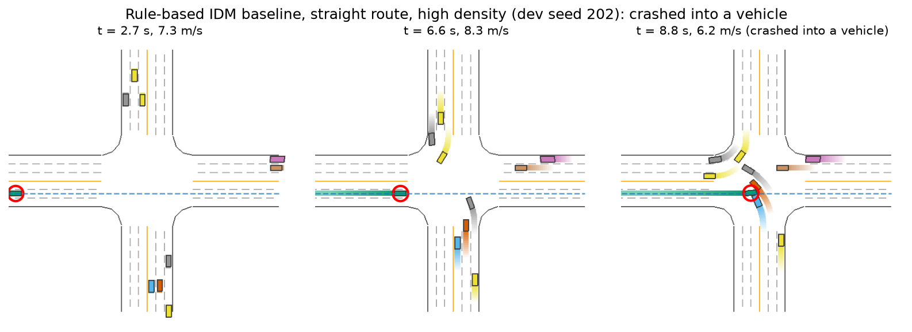

# MPC: what was done (notes for the report)

All results below are on **development seeds**. The held-out test seeds have not been used yet.

## 1. Simulator setup and verification

- MetaDrive 0.4.3, installed from source. Everything runs headless; the full MetaDrive test suite passes
  except tests that need a display.
- **Reproduced a published MetaDrive result** to check the setup: MetaDrive's pretrained expert policy, against
  the thresholds in MetaDrive's own tests: **4/4** configurations reproduced (rewards 339–412, success rate 1.0
  where required).

> Suggested sentence: *"We verified our setup by reproducing the documented performance of MetaDrive's
> pretrained expert policy (4/4 test configurations)."*

## 2. Scenario

- MetaDrive 4-way intersection (map `"X"`), routes of 110–125 m. The seed chooses the exit (left / straight /
  right) and the initial traffic, and the same seed gives the same initial traffic for every controller.
- Two traffic densities: **low = 0.1** (~3 vehicles) and **high = 0.3** (~9 vehicles).
- Control period 0.1 s. An episode ends at the goal, on a crash, on leaving the road (including touching a solid
  line), or after 60 s.
- Disjoint seed sets: tuning 200–299, test 0–199.

## 3. Interface and vehicle model

- **Information:** one state built per step: ego state, vehicles within 50 m, route and road edges. The MPC
  reads only this.
- **Actions:** MetaDrive's normalized [steering, throttle/brake].
- **Vehicle model**, identified from simulator data (system identification):
  - Acceleration is linear in throttle/brake and speed (R² = 0.97).
  - **Steering takes effect one step (0.1 s) late.** Modelling this raised the yaw-rate fit from R² = 0.74 to
    0.93.
  - Open-loop prediction error over a 2 s horizon: 0.46 m median position error (0.98 m at the 90th percentile),
    2.2° heading error.
- **Traffic prediction:** constant velocity.
- **Metrics:** goal-reaching / crash / off-road / timeout rates with 95% Wilson confidence intervals, travel
  time, minimum bounding-box clearance, decision time per step, and paired exact McNemar tests.

## 4. The MPC

- Nonlinear MPC with CasADi + IPOPT, 2 s horizon (20 steps of 0.1 s), receding horizon, warm-started from the
  previous solution. IPOPT capped at 60 iterations / 80 ms wall-clock time.
- Cost: lateral and heading error to the route, curvature-limited target speed, control effort and control
  changes, a road-edge penalty (accounting for the car's corners when it is yawed), and a Gaussian proximity cost
  around each predicted traffic vehicle.

## 5. Results so far (dev seeds, success rate)

| Controller | Seeds per density | Low density | High density | Decision time |
|---|---|---|---|---|
| **MPC** (CasADi/IPOPT, 2 s horizon) | 100 | **1.00** | **0.97** | ~7 ms mean (95th percentile ~15 ms) |
| MetaDrive pretrained expert | 20 | 0.95 | 0.85 | 1.3 ms |
| Rule-based IDM (MetaDrive) | 20 | 0.75 | 0.50 | 0.1 ms |

- **Road-edge cost:** the first version failed mainly by leaving the road. Waiting for crossing traffic at left
  turns, it steered away from the predicted cars and onto the solid edge line. Adding a road-edge cost raised
  success from 0.95/0.70 to 1.00/0.85 (20 seeds).
- **Solver robustness:** IPOPT failed to converge on 5–7% of steps, mostly around the intersection, because of
  two non-smooth points in the vehicle model (the throttle/brake switch and the zero-speed clamp). Smoothing them
  raised convergence to >99.5%, cut the 95th-percentile decision time from ~45–60 ms to ~15 ms, and removed all
  "waited too long" timeouts: 0.97/0.91 → 1.00/0.97 on 100 dev seeds (high density: 6 seeds fixed, none broken;
  McNemar p = 0.03).
- **Traffic cost shape:** a Gaussian proximity cost (never zero) works far better than a hinge cost (zero
  outside a safety ellipse): 1.00/0.97 vs 0.78/0.57. The Gaussian makes the MPC react to traffic early.
- **Remaining failures** (3 of 100, high density) show the limits of the simple models: one crash with an
  oncoming car turning into the same exit road (constant-velocity prediction assumed it would go straight), one
  side impact while stopped mid-turn (traffic does not yield), and one road departure after oscillating next to
  oncoming adjacent-lane traffic.

## 6. Example figures

Rendered from the simulator with MetaDrive's top-down view (`python scripts/make_figures.py`). The ego is
circled in red and its planned route is dashed. All use development seeds.

**Scenario at both traffic densities** (same seed; traffic appears as the ego approaches):

**MPC completing a left turn in high-density traffic.** It slows to 3.7 m/s while crossing traffic passes, then
completes the turn:

**Why the MPC needed a road-edge cost** (same seed, same moment). Without it, the MPC steers away from the
predicted crossing cars and touches the road edge, which ends the episode as off road. With it, the MPC brakes,
waits, and later reaches the goal. Traffic differs slightly between panels because the other cars react to the
ego:

**A failure of the rule-based IDM baseline.** A car turning out of the side road hits the ego in the middle of
the intersection. MetaDrive's traffic does not yield at crossings, so some crashes are not caused by the
controller alone:

## 7. Still to do

- Experiments: steering delay removed from the model, horizon length (1 / 2 / 3 s) vs success and decision time.
- Freeze the settings, then evaluate on the held-out test seeds (50 per density) with confidence intervals.
