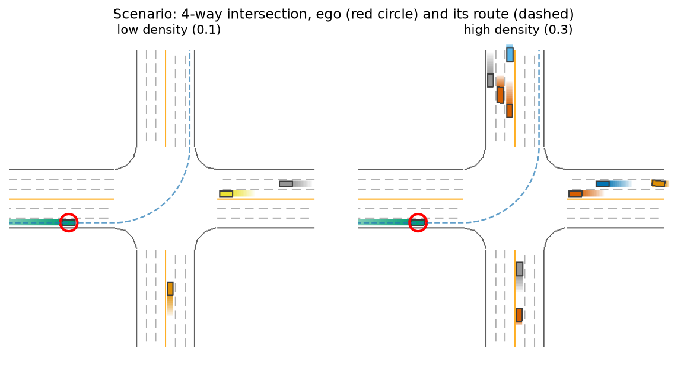
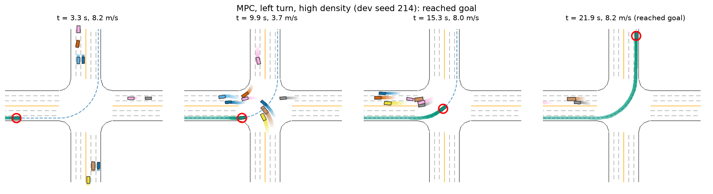
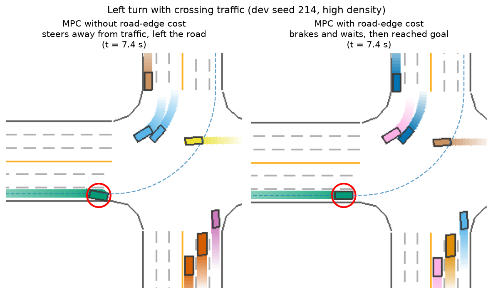

# What we did so far (notes for the report)

All results below are on **development seeds** (20 per traffic density) unless stated otherwise. The held-out
test seeds have not been used yet.

## 1. Simulator setup and verification

- MetaDrive 0.4.3, installed from source. Everything runs headless; the full MetaDrive test suite passes
  except tests that need a display.
- **Reproduced published MetaDrive results** to check our setup before trusting our own numbers:
  - **Official Stable-Baselines3 PPO tutorial** (same config, hyperparameters, 300k steps, same evaluation):
    episode reward **169.7** vs **168.7** published (tutorial's seed). Two more seeds gave 168.1 and 143.2 (the
    last one left the road), which shows how much a single PPO run can vary.
  - **MetaDrive's pretrained expert policy**, against the thresholds in MetaDrive's own tests: **4/4**
    configurations reproduced (rewards 339–412, success rate 1.0 where required).
  - **Not reproduced:** the MetaDrive paper's generalization experiment (Li et al., Sec. V-B, Fig. 8). It reports
    results only as a plot and omits key settings (number of maps, traffic density, training budget).

> Suggested sentence: *"We verified our setup by reproducing MetaDrive's official PPO tutorial (episode reward
> 169.7 vs. 168.7 published) and the documented performance of MetaDrive's pretrained expert policy
> (4/4 test configurations)."*

## 2. Scenario

- MetaDrive 4-way intersection (map `"X"`), routes of 110–125 m. The seed chooses the exit (left / straight /
  right) and the initial traffic, and the same seed gives the same initial traffic for every method.
- Two traffic densities: **low = 0.1** (~3 vehicles) and **high = 0.3** (~9 vehicles).
- Control period 0.1 s. An episode ends at the goal, on a crash, on leaving the road (including touching a solid
  line), or after 60 s.
- Disjoint seed sets: PPO training 1000–5999, tuning 200–299, test 0–199.

## 3. Shared interface (keeps the comparison fair)

- **Same information:** all methods use one state, built once per step: ego state, vehicles within 50 m, route
  and road edges. PPO receives it as a 71-number vector; MPC/MPPI read it directly.
- **Same actions:** all methods output MetaDrive's normalized [steering, throttle/brake].
- **Same model** for MPC and MPPI, identified from simulator data (system identification):
  - Acceleration is linear in throttle/brake and speed (R² = 0.97).
  - **Steering takes effect one step (0.1 s) late.** Modelling this raised the yaw-rate fit from R² = 0.74 to
    0.93.
  - Open-loop prediction error over a 2 s horizon: 0.46 m median position error (0.98 m at the 90th percentile),
    2.2° heading error.
- **Same traffic prediction** for MPC and MPPI: constant velocity.
- **Metrics:** goal-reaching / crash / off-road / timeout rates with 95% Wilson confidence intervals, travel
  time, minimum bounding-box clearance, decision time per step, and paired exact McNemar tests between methods.

## 4. Results so far (dev seeds, success rate)

| Method | Low density | High density | Mean decision time |
|---|---|---|---|
| Rule-based IDM (MetaDrive) | 0.75 | 0.50 | 0.1 ms |
| MetaDrive pretrained expert | 0.95 | 0.85 | 1.3 ms |
| **MPC** (CasADi/IPOPT, 2 s horizon) | **1.00** | **0.85** | 9.5 ms (95th percentile 57 ms) |
| PPO, first run (1M steps) | 0.20 | 0.10 | 0.3 ms |

- **MPC:** the first version failed mainly by leaving the road. Waiting for crossing traffic at left turns, it
  steered away from the predicted cars and onto the solid edge line. Adding a road-edge cost raised success from
  0.95/0.70 to 1.00/0.85. Decisions stay within the 100 ms control period.
- **PPO, first run:** never completed a turn (0 of 34 turning routes vs 6 of 12 straight). With MetaDrive's
  default reward, leaving the road costs only −5, so speeding and failing at the turn earns nearly as much as
  finishing. We will retrain with larger crash and off-road penalties.

## 5. Example figures

Rendered from the simulator with MetaDrive's top-down view (`python scripts/make_figures.py`). The ego is
circled in red and its planned route is dashed. All use development seeds.

**Scenario at both traffic densities** (same seed; traffic appears as the ego approaches):

**MPC completing a left turn in high-density traffic.** It slows to 3.7 m/s while crossing traffic passes, then
completes the turn:

**Why MPC needed a road-edge cost** (same seed, same moment). Without it, MPC steers away from the predicted
crossing cars and touches the road edge, which ends the episode as off road. With it, MPC brakes, waits, and
later reaches the goal. Traffic differs slightly between panels because the other cars react to the ego:

**A failure of the rule-based IDM baseline.** A car turning out of the side road hits the ego in the middle of
the intersection. MetaDrive's traffic does not yield at crossings, so some crashes are not caused by the
controller alone:

## 6. Still to do

- MPPI (same model, cost and traffic prediction as MPC).
- PPO retraining with the new reward, using several seeds.
- Final evaluation on the held-out test seeds (50 per density) with confidence intervals and paired tests.
